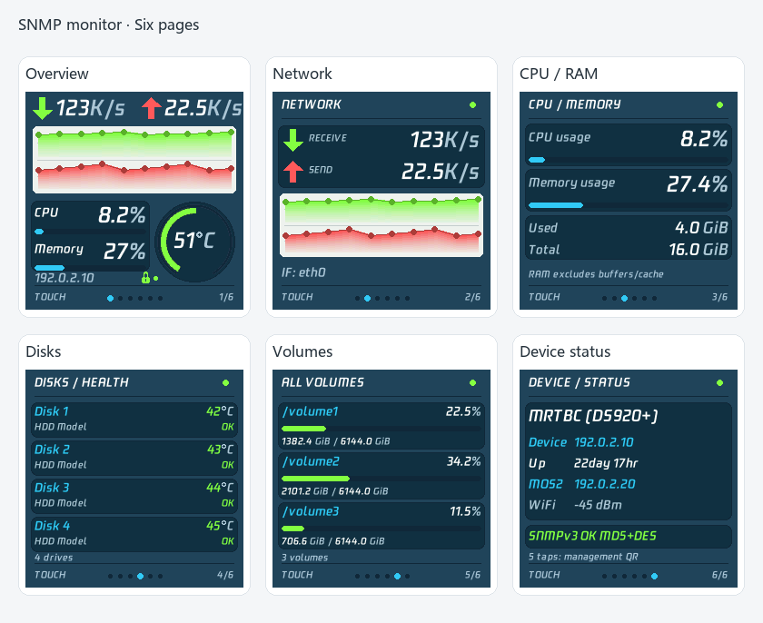
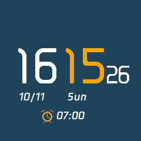
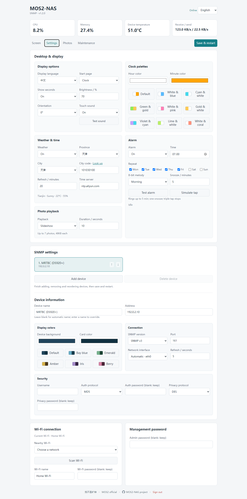
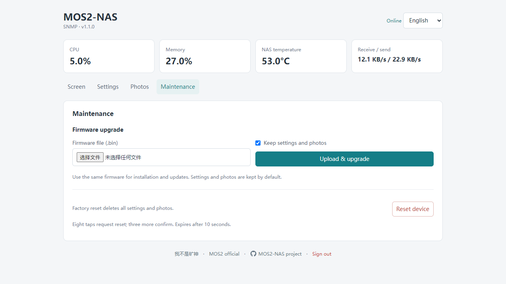

# MOS2-NAS

[简体中文](README.md) · **English**

**Version 1.2.0** · Desktop and multi-device SNMP monitor for MOS2 · **MIT License**

Monitor CPU, memory, network traffic, system temperature, disk health and storage volumes through SNMP v2c / v3. No Netdata installation is required. Includes a weather clock, photo album, buzzer alarms, QR Wi-Fi setup and bilingual web management.

Hardware: **MOS2 · ESP8266 / ESP-12F · 4MB Flash · ST7789 240×240**.

[Download firmware and simulator](https://github.com/tbc0309/mos2-nas-monitor/releases/latest) · [3D-printable case](docs/3D_PRINT_CASE.en.md)

## Main features

- Up to **6 devices**, separate names/colors/credentials and profile ordering. Editing a profile does not switch the screen target.
- v2c / v3, MD5 / SHA authentication and DES / AES privacy; independent caches, bounded retries and page-aware collection.
- 9 clock palettes and 6 device palettes; verified city codes and scrolling city names.
- All settings take effect after saving and restarting. Add, remove and reorder devices before one final save and restart. New logins replace the previous session.

## Interface previews

### SNMP monitoring

Six pages, rendered by the shared firmware drawing code using sample data.



Green represents traffic received by the NAS; red represents traffic sent. Downloads occupy the upper half of the chart and uploads the lower half. Each trend scales independently; use the numeric values to compare actual rates.

### Clock and weather

The original large clock digits and weather animation are retained. Hours default to white and minutes to orange, with separate color controls. Enabled alarms show an icon and time.

<table width="100%">
<tr><th width="50%">Clock with alarm</th><th width="50%">Weather and time</th></tr>
<tr><td align="center"></td><td align="center"></td></tr>
</table>

### Web management

Configure the display, weather, alarms, SNMP devices, Wi-Fi and album in a browser. Switch the web language in the upper right; display language is configured separately.



### 3D-printable case

The MOS2 TV-style enclosure includes 11 STL models, two stand styles, a complete archive and color renders. See the [case download and printing guide](docs/3D_PRINT_CASE.en.md). The compatible [MOS2 board is available on Taobao](https://item.taobao.com/item.htm?id=854776370120).


**Front case with integrated legs:** no separate stand is required; 5° and 8° viewing angles are included.


**Standard front case with a separate stand:** choose the compact stand or a retro four-leg TV stand with a 10° or 15° viewing angle.


## Quick start

### Install

Download `MOS2-NAS-1.2.0.bin` from [Releases](https://github.com/tbc0309/mos2-nas-monitor/releases/latest). One file contains the application and fonts. Use USB for first installation, older firmware or mismatched resources; compatible resources also allow web updates.

For a fresh installation, replace `COM7` with your serial port:

```shell
python -m pip install esptool
python -m esptool --port COM7 erase-flash
python -m esptool --port COM7 --baud 460800 write-flash --flash-mode dio --flash-size 4MB 0x0 MOS2-NAS-1.2.0.bin
```

A fresh USB installation clears settings and photos. Use the web updater to preserve existing user data.

### Wi-Fi and login

1. On first boot, scan the display QR code to join `MOS2-NAS-xxxxxx`. The hotspot password is `12345678`.
2. Open `http://192.168.4.1/`, scan for a 2.4GHz network, select it and save its password. Hidden SSIDs can be entered manually.
3. After connection, tap five times to display the management QR code.
4. The default management password is `12345678`. First login requires changing it and signing in again.

With saved settings, the device reconnects automatically. Wi-Fi setup opens only on first initialization or after six taps. Management sessions expire after 30 minutes of inactivity or a reboot.

### Connect a Synology NAS

Enable SNMP in DSM under **Control Panel → Terminal & SNMP → SNMP**, then fill in the NAS settings:

| Mode | Required settings |
| --- | --- |
| SNMP v2c | Device address, community and port |
| SNMP v3 | Device address, username, authentication protocol and password; optional privacy protocol and password |

SNMPv3 supports **MD5 / SHA** authentication and **DES / AES** privacy. The default port is `161`. Network interface selection defaults to automatic; discovered interfaces can be selected later. Leave password fields blank to retain their current values.

Management uses local HTTP. Use it on a trusted network. Additional configuration notes: [SNMP documentation (Chinese)](docs/SNMPV3.md).

## Tested support

| Tested system | CPU / RAM / network / uptime | Temperature | Disks / health | Volumes |
| --- | --- | --- | --- | --- |
| Synology DS920+ | Supported | System and disks | Model, temperature, health | Top-level volumes |
| fnOS | Supported | CPU Package | SATA / USB names; no SMART | System, data, USB |
| Ubuntu | Supported | CPU Package | SATA names; no SMART | System and data mounts |
| iStoreOS | Supported | Configured SNMP CPU extension, verified | Basic SATA / USB capacity; no SMART | System and data mounts |
| OpenWrt | Supported | Agent-provided sensor | Tested agent does not expose eMMC disks | Exposed mounts |
| TerraMaster TOS test environment | Supported | ACPI sensor in this environment | Basic SATA capacity; no SMART | Exposed mounts |

Checked on 2026-10-12. Models and agent builds can differ. Dashboard fields do not prove SNMP support. RAID/LVM is not counted as extra physical disks. USB volumes must be mounted and exported. [Detailed evidence (中文)](docs/COMPATIBILITY.md).

Install missing agents with the [copy-and-run guide](docs/SNMP_INSTALL.en.md). Automatic names prefer an ASCII uname hostname in sysDescr; unsafe or unrecognized names trigger a validated sysName fallback. Custom names take precedence; Synology uses its vendor model.

## Touch controls

Desktop pages: **Clock → Weather → Album**.

NAS pages: **Overview → Network → CPU / Memory → Disk health → Volumes → Device status**.

| Consecutive taps | Action |
| --- | --- |
| 1 | Next page; return from management or setup display |
| 2 | Switch device on overview / status, keeping the page; next photo or disk/volume group |
| 3 | Switch desktop / NAS mode |
| 5 | Management QR code |
| 6 | Wi-Fi setup hotspot and QR code |
| 8 | Reset confirmation; a separate triple tap confirms |

Keep gaps between taps below approximately 350ms. Recognition completes after the last release. Four taps, seven taps and long presses have no assigned action. Reset confirmation cancels after ten seconds or another tap sequence.

While an alarm is ringing or snoozed, **one tap snoozes and three taps stop that day's alarm**, taking priority over navigation.

## Configuration

| Section | Settings |
| --- | --- |
| Desktop & display | Display language, startup page, clock colors, seconds, brightness, rotation, touch sound |
| Weather & time | City code with lookup link, refresh interval, NTP server |
| Alarm | Time, weekdays, four 8-bit melodies, snooze duration |
| Photo playback | Slideshow or fixed photo, display duration |
| NAS | Background color, SNMP settings, interface, refresh interval |
| Wi-Fi / admin password | Scan networks, view connection, change credentials |
| Album | Upload, crop, zoom, rotate, add or replace a slot |
| Maintenance | Firmware update, data retention, factory reset |

Weather defaults to Tianjin (`101030100`), refreshed every 20 minutes by default (configurable from 10 to 120 minutes). NTP defaults to `ntp.aliyun.com`, timezone UTC+8. Scheduled alarms require synchronized time. Alarms default to weekdays; snooze supports 1–30 minutes.

The album holds **up to seven 240×240 JPEG photos, at most 48KB each**. Double tap to change photos in fixed mode.

### Monitoring behavior

- CPU usage uses cumulative counter differences, excluding idle and I/O wait.
- Memory usage excludes free memory, buffers and cache; sample timing may differ from DSM.
- Network rates use IF-MIB Counter64 differences, in bytes per second.
- The temperature ring is green below 60°C, orange at 60–74°C and red from 75°C. These are display thresholds, not DSM alarm settings.
- Up to 12 disks and eight `/volumeN` volumes are supported, grouped into four disks or three volumes per page.
- Data groups are collected and cached independently. Unknown data is displayed as unknown.
- Startup prioritizes the selected page. Disk health refreshes hourly, disk temperature every five minutes and volume usage every two hours. NAS uptime advances locally after the first reading and synchronizes every two hours.
- Global request spacing, a single pending request and failure backoff limit NAS load.

## Update and reset

Under **Maintenance → Firmware update**, select `MOS2-NAS-1.2.0.bin`. **Keep settings and photos** is enabled by default. Unchecking it clears user data only after a validated, successful update; validation failure does not clear data.



The updater validates the full file, extracts the application and retains compatible system resources. Use USB installation when firmware and font resources do not match.

Factory reset removes settings, the management password and all photos while retaining system fonts. Wi-Fi setup is required after reboot.

## Simulator

Usage, source execution and packaging: [simulator documentation](simulator/README.md).

## Documentation and development

[Firmware guide (中文)](docs/DEVELOPMENT.md) · [Module map (中文)](docs/STRUCTURE.md) · [Adapters (中文)](docs/TELEMETRY.md) · [Parameters (中文)](docs/PARAMETERS.md) · [Fonts (中文)](docs/FONTS.md) · [Contributing](CONTRIBUTING.md)

## License and credits

Original project code is licensed under [MIT](LICENSE). Third-party dependencies, fonts and reference assets retain their respective licenses; see [NOTICE](NOTICE.md).

Hardware, large clock digits, weather icons and animation reference JSRUN MOS2 / SmallDesktopDisplay. The NAS interface references routermonitor.

- [MOS2 official](https://jsrun.net/hw/mos2)
- [imnks.com](https://imnks.com/)

## Disclaimer

This is a personal Vibe Coding project and is not affiliated with MOS2 or any related Taobao store. No technical support or discussion service is provided. If you encounter a problem, consult the documentation or ask an AI assistant for help.
