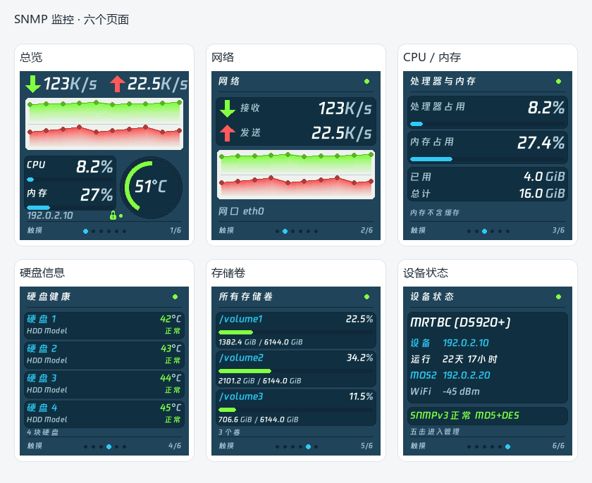
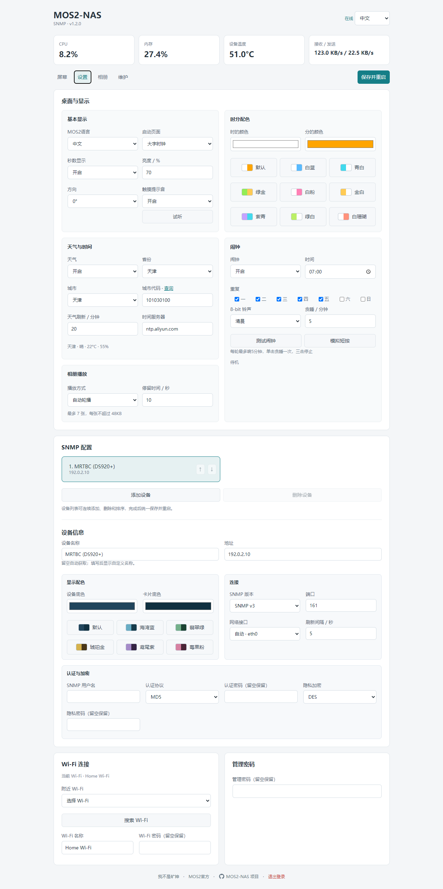
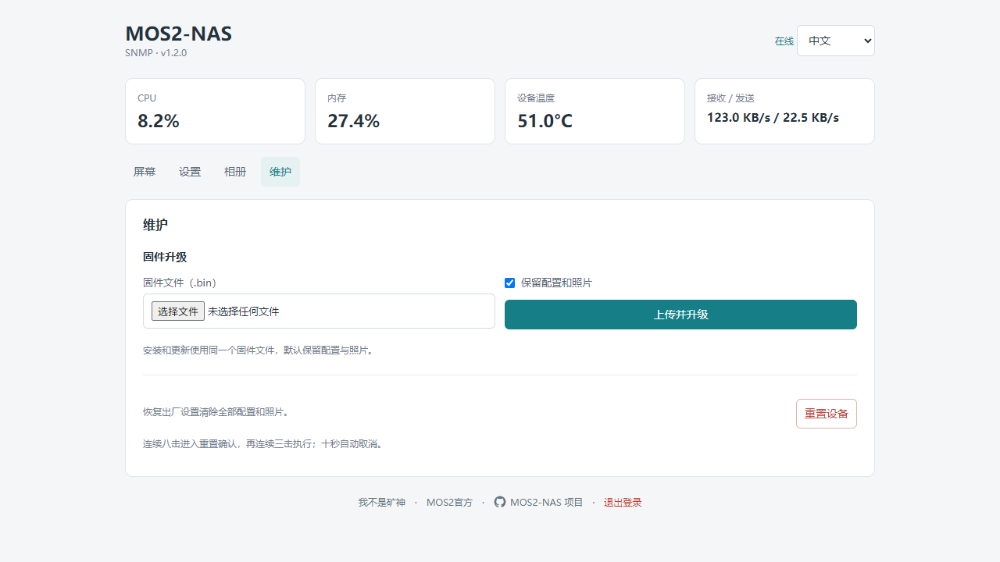

# MOS2-NAS

**简体中文** · [English](README.en.md)

**版本 1.2.0** · MOS2 的桌面与 SNMP 多设备监控固件 · **MIT License**

通过 SNMP v2c / v3 获取 CPU、内存、网络速率、系统温度、硬盘健康和存储卷信息，无需安装 Netdata。同时提供天气时钟、相册、蜂鸣器闹钟、扫码配网和中英文网页管理。

适用硬件：**MOS2 · ESP8266 / ESP-12F · 4MB Flash · ST7789 240×240**。

[下载固件与模拟器](https://github.com/tbc0309/mos2-nas-monitor/releases/latest) · [快速开始](#快速开始) · [触摸操作](#触摸操作) · [实测支持](docs/COMPATIBILITY.md) · [安装 SNMP](docs/SNMP_INSTALL.md) · [固件开发](docs/DEVELOPMENT.md)

## 主要功能

- 最多 **6 台设备**，分别配置名称、显示配色与 SNMP 参数，后台支持排序；编辑设备不改变屏幕目标。
- v2c / v3，MD5 / SHA 认证、DES / AES 加密；当前页面优先采集，独立缓存与失败退避。
- 时钟 9 套、设备 6 套预设配色；天气支持地级市选择、自定义代码校验与长名称滚动。
- 设置统一保存并重启生效；添加、删除和排序设备可以完成后统一重启。管理只保留一个有效会话。

## 界面预览

### SNMP 监控

总览、网络、CPU / 内存、硬盘健康、存储卷和设备状态六个页面。以下预览由固件共用的绘图代码生成，使用示例数据。



红色表示设备发送，绿色表示设备接收。绿色下行位于上半区、红色上行位于下半区，各占一半高度；两条曲线分别按各自峰值缩放，用于查看变化趋势；实际速率以上方数字为准。

### 桌面与天气

保留原版大时钟数字和天气动画。默认时白、分橙，颜色可独立调整；闹钟开启时显示图标和时间。

<table width="100%">
<tr><th width="50%">大字时钟（开启闹钟）</th><th width="50%">天气与时间</th></tr>
<tr><td align="center"></td><td align="center"></td></tr>
</table>

### 网页管理

在浏览器中配置显示、天气、闹钟、SNMP 设备、Wi-Fi 和相册。网页使用浏览器系统字体，语言可在右上角切换。



## 快速开始

### 安装固件

从 [Releases](https://github.com/tbc0309/mos2-nas-monitor/releases/latest) 下载 `MOS2-NAS-1.2.0.bin`。同一个文件用于 USB 全新安装和资源一致的网页升级，已包含程序与字库。从旧版升级或资源不匹配时使用 USB 完整刷入。也可使用 [MOS2 官方在线免费刷写](https://jsrun.net/hw/mos2)。

全新安装时，替换 `COM7` 为实际串口：

```shell
python -m pip install esptool
python -m esptool --port COM7 erase-flash
python -m esptool --port COM7 --baud 460800 write-flash --flash-mode dio --flash-size 4MB 0x0 MOS2-NAS-1.2.0.bin
```

USB 全新安装会清除配置和照片。已有设备需要保留数据时，使用管理页的固件升级功能。

### 配网与登录

1. 首次启动进入配网热点，扫描屏幕二维码加入 `MOS2-NAS-xxxxxx`，热点密码为 `12345678`。
2. 打开 `http://192.168.4.1/`，搜索并选择 2.4GHz Wi-Fi，输入密码后保存；隐藏网络可手动填写名称。
3. 等待设备联网，连续五击打开管理二维码，扫码进入管理页。
4. 默认管理密码为 `12345678`。首次登录必须修改密码，然后重新登录。

已有配置时自动联网，不因刷新或登录自动进入配网；需要重新配网时六击。新登录替换旧会话，避免多个浏览器同时编辑。管理会话闲置 30 分钟或设备重启后需要重新登录。

### 添加监控设备

在 DSM 的 **控制面板 → 终端机和 SNMP → SNMP** 中开启对应服务，并在设备管理页的 **SNMP 配置** 卡片填写：

| 模式 | 配置内容 |
| --- | --- |
| SNMP v2c | 设备地址、Community、端口 |
| SNMP v3 | 设备地址、用户名、认证协议与密码；需要加密时再填写隐私协议与密码 |

SNMP v3 支持 **MD5 / SHA** 认证和 **DES / AES** 隐私加密。端口默认 `161`，网络接口默认自动选择；连接后可从列表选择具体网口。密码类字段留空表示保留原值。

详细配置见 [SNMP v3 说明](docs/SNMPV3.md)。设备通过局域网 HTTP 提供管理页面，请在可信局域网中使用。

## 实测支持

| 实测系统 | CPU / 内存 / 网络 / 运行时间 | 温度 | 硬盘与健康 | 存储卷 |
| --- | --- | --- | --- | --- |
| 群晖 DS920+ | 支持 | 系统＋硬盘 | 型号、温度、健康 | 顶层卷 |
| fnOS | 支持 | CPU Package | SATA / USB 基础信息，无 SMART | 系统、数据、USB |
| Ubuntu | 支持 | CPU Package | SATA 基础信息，无 SMART | 系统与数据挂载 |
| iStoreOS | 支持 | 已配置的 SNMP CPU 扩展，实测通过 | SATA / USB 基础容量，无 SMART | 系统与数据挂载 |
| OpenWrt | 支持 | 当前代理的传感器 | 本轮 eMMC 未通过 SNMP 暴露 | 已暴露的挂载 |
| 铁威马 TOS 测试环境 | 支持 | 本轮为 ACPI 温度 | SATA 基础容量，无 SMART | 已暴露的挂载 |

2026-10-12 实际核对。同品牌不同型号/代理可能不同；系统后台能显示，不代表 SNMP 一定提供。未知字段不伪造，RAID/LVM 不重复计算为物理盘。USB 卷须挂载并由代理暴露。详见 [实测支持与边界](docs/COMPATIBILITY.md)。

Ubuntu / fnOS / OpenWrt / iStoreOS 没有代理时，按 [安装说明](docs/SNMP_INSTALL.md) 复制执行。名称留空自动获取，优先解析 sysDescr；含中文/CJK 或无法解析时查询并验证 sysName。群晖显示主机名与真实型号，自定义名称优先。

## 触摸操作

桌面组：**时钟 → 天气 → 相册**。

监控组：**总览 → 网络 → CPU / 内存 → 硬盘健康 → 存储卷 → 设备状态**。

| 连续短按 | 操作 |
| --- | --- |
| 单击 | 下一页；从管理或配网页面返回 |
| 双击 | 总览 / 设备状态切换设备并保留页面；下一张照片；硬盘或存储卷下一组 |
| 三击 | 切换桌面 / NAS 功能组 |
| 五击 | 打开管理二维码 |
| 六击 | 重新配网，打开热点二维码 |
| 八击 | 进入重置确认，再独立三击执行 |

相邻点击间隔短于约 350ms，最后一次松开后等待整组识别。四击、七击和长按不触发功能。重置确认十秒后自动取消，其他点击也会取消。

闹钟响铃或贪睡时，**单击贪睡、三击停止当天闹钟**优先于翻页。

## 功能配置

| 管理区域 | 可设置内容 |
| --- | --- |
| 桌面与显示 | 屏幕语言、启动页面、时分颜色、秒数、亮度、方向、触摸提示音 |
| 天气与时间 | 城市代码及查询链接、天气刷新间隔、NTP 服务器 |
| 闹钟 | 时间、周一至周日、四首 8-bit 铃声、贪睡时长 |
| 相册播放 | 自动轮播、固定显示、停留时间 |
| SNMP 配置 | 最多 6 台设备、排序、自定义名称、6 套显示配色、SNMP 参数和网络接口 |
| Wi-Fi / 管理密码 | 搜索网络、查看当前连接、修改 Wi-Fi 和管理密码 |
| 相册管理 | 上传、拖动裁剪、缩放、旋转、选择空位或替换照片 |
| 维护 | 固件升级、保留数据选项、恢复出厂设置 |

天气默认天津 `101030100`，默认每 20 分钟刷新，可设为 10–120 分钟。NTP 默认 `ntp.aliyun.com`，时区 UTC+8；时间未同步时不触发定时闹钟。闹钟默认工作日，最长响铃 5 分钟、只允许一次贪睡；贪睡可设 1–30 分钟。

相册最多 **7 张**，每张为 **240×240 JPEG，不超过 48KB**。固定显示模式下双击切换照片。

### NAS 数据说明

- CPU 根据原始计数器差值计算，空闲和 I/O 等待不计入忙碌时间。
- 内存扣除空闲、buffers 和 cache，尽量贴近 DSM 资源监控；采样时刻不同可能有差异。
- 网络速率根据 IF-MIB Counter64 差值计算，单位为字节每秒。
- 温度优先使用系统专用字段，否则读取代理暴露的传感器或已配置的 CPU 温度扩展。圆环低于 60°C 为绿色，60–74°C 为橙色，75°C 起为红色；这是固件提示阈值，不代表 DSM 的报警阈值。
- 最多显示 12 块硬盘、8 个存储卷；群晖只保留顶层 `/volumeN` 和 USB 挂载，其他系统读取磁盘挂载；每组 4 块硬盘或 3 个卷，双击翻组。
- 各类数据独立采集、缓存和重试；未知字段显示未知。

## 升级与重置

管理页 **维护 → 固件升级** 选择同一个 `MOS2-NAS-1.2.0.bin`，默认勾选“保留配置和照片”。取消勾选后，验证并升级成功才清除用户数据；校验失败不清除数据。



网页会校验完整文件，提取程序区升级并保留兼容的系统资源。程序与字库不匹配时，通过 USB 安装完整文件。分区与校验机制见 [文件系统与升级](docs/FILESYSTEM.md)。

恢复出厂设置删除配置、管理密码和全部照片，保留系统字库；重启后重新配网。

## 模拟器

使用、源码运行和打包说明见 [模拟器文档](simulator/README.md)。

## 文档与开发

[文档目录](docs/README.md) · [固件构建](docs/DEVELOPMENT.md) · [模块结构](docs/STRUCTURE.md) · [系统适配](docs/TELEMETRY.md) · [参数](docs/PARAMETERS.md) · [字库](docs/FONTS.md) · [绘图](docs/RENDERING.md) · [贡献](CONTRIBUTING.md)

## 开源协议与来源

本项目原创代码采用 [MIT 开源协议](LICENSE)。第三方依赖、字体和参考素材遵循各自的许可，详见 [NOTICE](NOTICE.md)。

硬件、大时钟、天气图标和动画参考 JSRUN MOS2 / SmallDesktopDisplay，NAS 界面参考 routermonitor。

- [MOS2 官方](https://jsrun.net/hw/mos2)
- [我不是矿神](https://imnks.com/)
