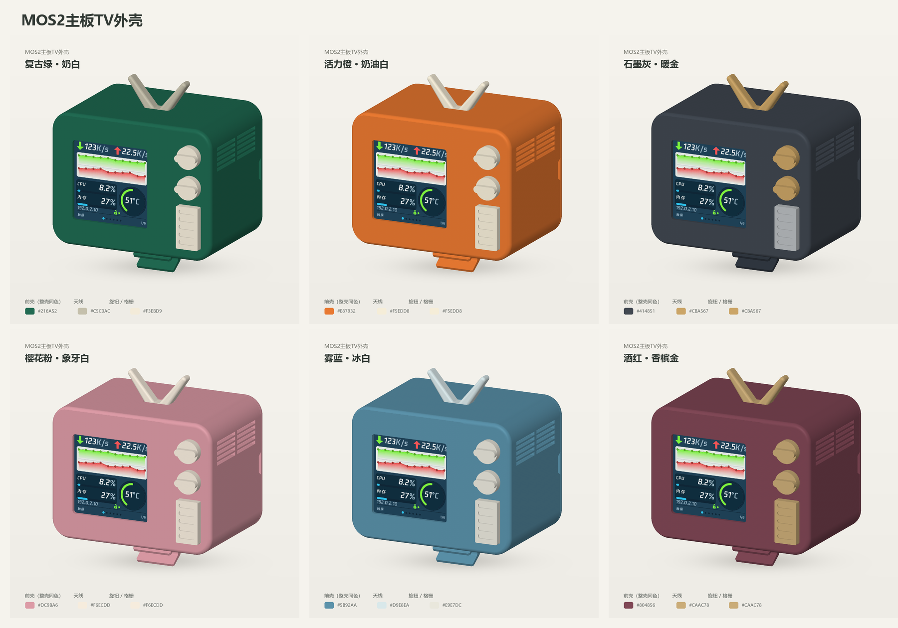
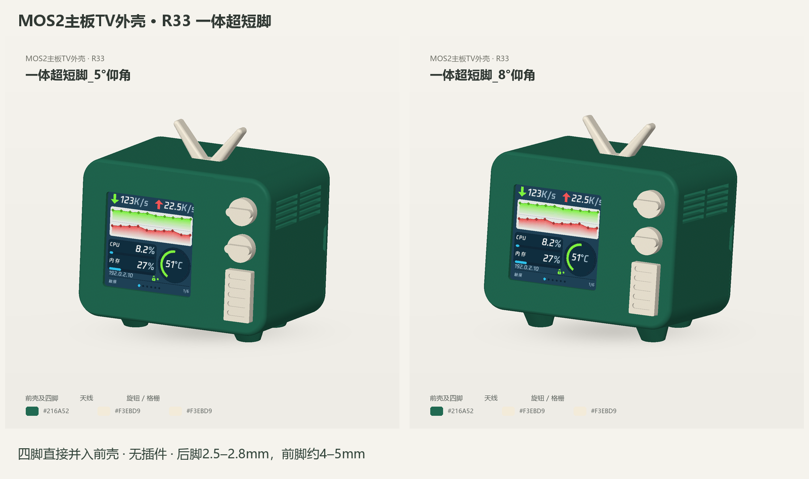
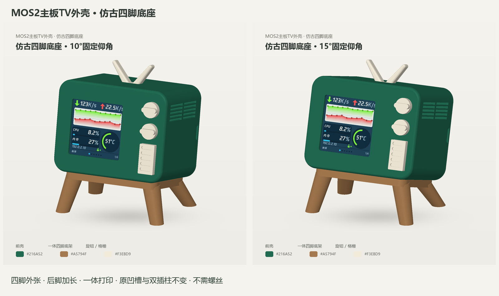

# MOS2 TV 3D-printable case

[中文说明](../../docs/3D_PRINT_CASE.md) · [English guide](../../docs/3D_PRINT_CASE.en.md)

[Compatible MOS2 board on Taobao](https://item.taobao.com/item.htm?id=854776370120)

Download [MOS2-TV-3D-PRINT-CASE.zip](MOS2-TV-3D-PRINT-CASE.zip) for all 11 STL models and the available stand options.

## Front case with integrated legs

Choose `1-Front-Case_Four-Leg-5deg.stl` or `1-Front-Case_Four-Leg-8deg.stl`. These models include short legs and do not require a separate stand.

## Standard front case with a separate stand

Use `1-Front-Case.stl` with the compact `4-Base.stl`, or select `4-Base-Retro-Four-Leg-10deg.stl` or `4-Base-Retro-Four-Leg-15deg.stl` for a retro TV-style four-leg stand.

